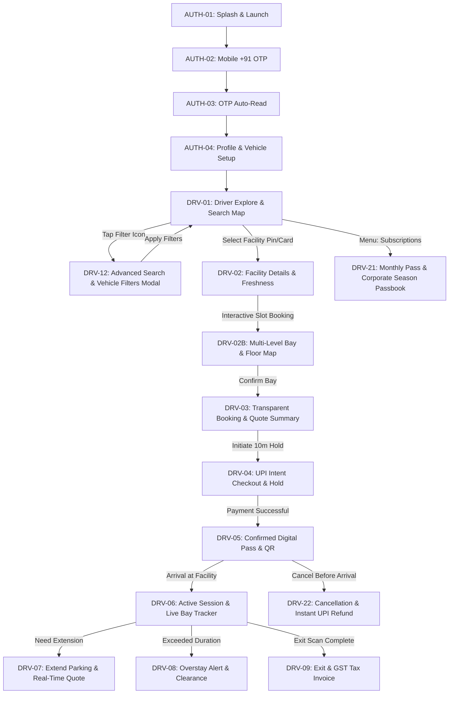
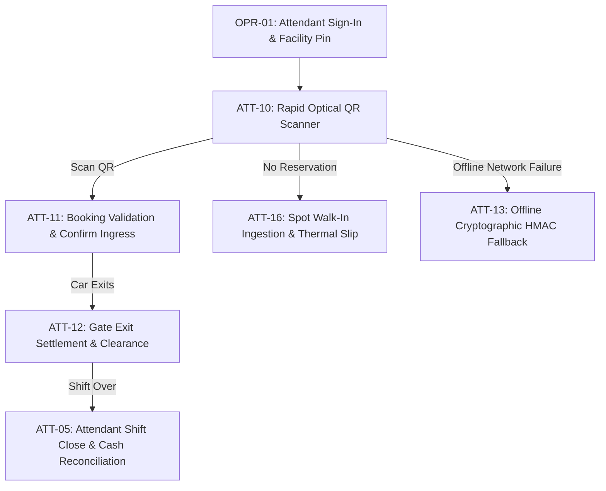
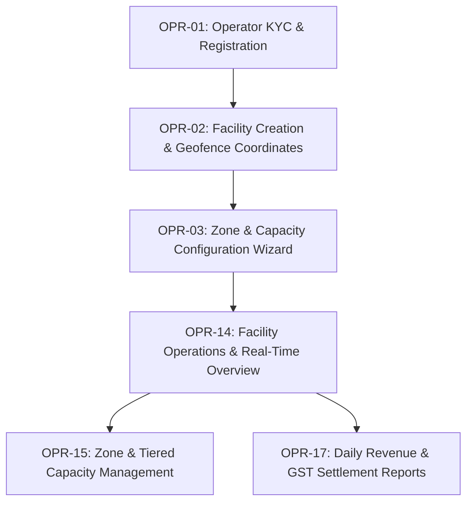
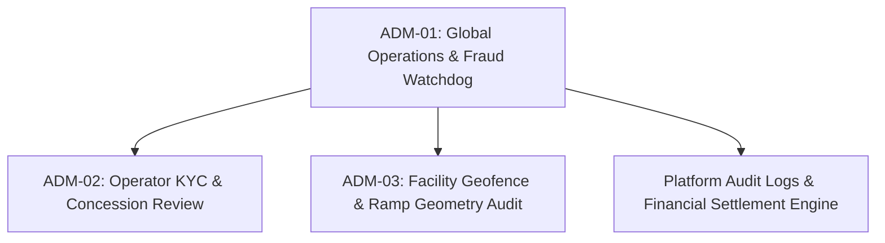

# SmartPark India — Master UI Workflow, Design System & Functional Specification

> **Project Name:** SmartPark India (Smart Parking Mobile App & Operator SaaS)  
> **Stitch Suite URL:** [https://stitch.withgoogle.com/projects/15000274080821385749](https://stitch.withgoogle.com/projects/15000274080821385749)  
> **Stitch Project Identifier:** `projects/15000274080821385749`  
> **Interactive Local Prototype:** [`prototype/index.html`](file:///Users/maheshgiri/Documents/Projects/Parking/prototype/index.html)  
> **Design System Asset:** `assets/6f2cd872370148b5b2e7904ab1d527b9` (Urban Mobility & Smart Transit)  
> **Theme:** Material 3 Transit HUD • Daylight Outdoor Legibility • Plus Jakarta Sans & Inter • Navy `#0F172A` & Mobility Teal `#0D9488`  
> **Version:** 3.0 (Professional UI & Graphics Designer Suite)  
> **Target Framework:** Flutter (Clean Architecture) & Responsive Web SaaS Console

---

## 1. Executive Summary & Design System Foundations

The SmartPark India platform addresses urban transit congestion, opaque parking tariffs, and manual gate bottlenecks across major Indian metro transit hubs (Delhi NCR, Mumbai MMR, Bengaluru, Hyderabad, Chennai, Pune).

To overcome the visual fragmentation and inconsistent feature depth identified in earlier concept mockups, the entire platform has been re-architected into a **unified 4-role design language** with strict WCAG 2.1 AAA outdoor legibility, standardized 8-point spatial rhythm, and realistic Indian transit invariants (FASTag/UPI escrow, 18% GST tax invoicing, HSRP number plates, multi-level ramp clearances).

```
                      ┌───────────────────────────────────────────────┐
                      │              SmartPark Platform               │
                      └──────────────────────┬────────────────────────┘
                                             │
      ┌──────────────────────┬───────────────┴───────────────┬──────────────────────┐
      ▼                      ▼                               ▼                      ▼
┌─────────────┐       ┌──────────────┐                ┌──────────────┐       ┌─────────────┐
│   Driver    │       │  Attendant   │                │   Operator   │       │ Super Admin │
│ Mobile App  │       │ Field POS/UI │                │ Manager SaaS │       │ Web Console │
└─────────────┘       └──────────────┘                └──────────────┘       └─────────────┘
```

---

## 2. Core Design System Tokens & Guidelines

### 2.1 Color Palette (Outdoor High-Contrast Standard)

The color palette is engineered specifically for glare-heavy sunlight exposure on two-wheeler mounts, windshield cradles, and field attendant POS screens:

| Token Name | Hex Code | Role & Usage |
| :--- | :--- | :--- |
| `primary` | `#0F172A` | Deep Slate / Institutional Navy for headers, navigation bars, primary branding, and HSRP badges. |
| `secondary` | `#0D9488` | Electric Mobility Teal for primary CTAs, active touch targets, route tracking, and active slot selections. |
| `secondary-container` | `#86F2E4` | Soft teal container tint for active vehicle cards, selected chips, and positive focus rings. |
| `surface` | `#F8F9FF` | Ultra-clean canvas background (avoids muddy grays; stays crisp in direct sunlight). |
| `surface-container-lowest` | `#FFFFFF` | Pure white card surfaces, floating bottom sheets, and high-visibility QR pass cards. |
| `surface-container-low` | `#EFF4FF` | Soft tinted card backgrounds, secondary tags, and unselected filter chips. |
| `outline` / `border` | `#E2E8F0` | Structural 1px boundary border preventing visual bleed between adjacent modules. |
| `status-available` | `#15803D` / `#DCFCE7` | Confirmed real-time parking space available (< 10m telemetry freshness). |
| `status-caution` | `#B45309` / `#FEF3C7` | Filling fast (> 85% occupied) or moderate freshness warning. |
| `status-full` / `error` | `#B91C1C` / `#FEE2E2` | Zone fully occupied, reservation overstay penalty, or invalid QR credentials. |
| `status-unverified` | `#475569` / `#F1F5F9` | Stale or community-estimated availability (dashed border; honest reporting invariant). |

### 2.2 Typography Scale (Plus Jakarta Sans)

Selected for its balanced geometric numerals, wide counters, and unambiguous glyph distinction (crucial for differentiating `0` vs `O`, and `1` vs `I` on number plates):

* **Display Lg (`36px` / `44px`, Bold):** Splash branding, confirmed booking hero headlines.
* **Headline Lg (`30px` / `38px`, Bold):** Major section titles, total pricing quotes.
* **Headline Md (`20px` / `28px`, Semi-Bold):** Facility names, card headers, payment sheet titles.
* **Title Md (`16px` / `24px`, Semi-Bold):** Vehicle category labels, active bay IDs, time window chips.
* **Body Md (`14px` / `20px`, Regular):** Description paragraphs, address text, terms, helper labels.
* **Label Sm (`11px` / `14px`, Medium):** Freshness badges, tax breakdowns, pillar coordinates.
* **Data Currency (`22px` / `28px`, Bold, Tabular):** Always formatted with inline `₹` symbol (e.g. `₹120.00`) with zero numeric jitter during live counters.
* **Data Plate (`18px` / `24px`, Bold, Tabular, 0.1em Tracking):** Standardized uppercase monospaced license plate layout (e.g. `DL 01 AB 1234`).

### 2.3 Spatial Scale & Shape Architecture

* **Grid:** Strict 8-point spatial system (`space-xs: 4px`, `space-sm: 8px`, `space-md: 16px`, `space-lg: 24px`, `space-xl: 32px`).
* **Touch Targets:** Strict minimum of `48px × 48px` on all mobile interactive targets to prevent miss-taps during transit.
* **Corner Radii:**
  * Base Tags / Plate Badges: `8px` (`rounded-md`)
  * Container Cards & Vehicle Selectors: `16px` (`rounded-xl`)
  * Bottom Docked Sheets: `24px` top corners (`rounded-t-2xl`)
  * Status Indicators & Duration Pills: `9999px` (`rounded-full`)

---

## 3. End-to-End Workflow & Option Functionality

### 3.1 Role 1: Driver / Commuter Journey



#### Detailed Screen Options & Functional Invariants:

1. **`DRV-01 — Driver Explore & Search` (`687fffa3dc1940b493d798a502eeefc6`)**
   * *Top Bar:* Destination search bar with autocomplete (e.g. "Connaught Place", "Cyber Hub"), voice input button, geolocation GPS trigger.
   * *Vehicle Category Carousel (6 Classes):* Horizontal selector covering **Cycle**, **Two-Wheeler**, **Car**, **Auto-Rickshaw**, **Van/SUV**, **Heavy Truck**. Selecting a class dynamically filters facility compatibility.
   * *Interactive Map:* Real-time cluster pins color-coded by capacity: Green (Available), Amber (Filling Fast), Red (Full), Grey (Unverified).
   * *Facility Cards:* Display distance, estimated price, walking time to destination, opening hours, and **Availability Freshness Pill** (`Updated by operator 2m ago`).

2. **`DRV-12 — Advanced Search & Vehicle Filters Modal` (`42af4a4e713648f8ab25813d73b6b69a`)**
   * *Vehicle Fit & Clearance:* Automatic dimension matching against registered car (`Hyundai Creta: H: 1.63m, W: 1.79m`). Strict toggle: "Only show parking with > 2.0m clearance".
   * *Distance Slider:* 500m to 15km radius.
   * *Data Freshness Confidence:* Radio filter between "Operator Verified Live (< 10m)", "High Confidence (> 85% historic)", and "All Facilities".
   * *Structure Type:* Covered/Basement, Multi-Level Automated (MLCP), Open Surface, Valet.
   * *Budget & Amenities:* Hourly tariff slider (`₹20 - ₹80/hr`), CCTV, EV 60kW Fast Charging, Wheelchair elevator, Restrooms.

3. **`DRV-02 — Facility Details & Availability` (`25eda999044146558ab9f78c0641f1d3`)**
   * *Gallery & Header:* Facility hero photos, verified municipal certificate badge, opening hours (`24x7` or `07:00 - 23:00`).
   * *Entrance vs Boundary Navigation:* Exact coordinates for ingress ramp vs customer walking exit.
   * *Vehicle Compatibility Matrix:* Height clearance indicator, allowed vehicle classes, turnaround radius for vans.
   * *Tariff Schedule Table:* Hourly tiers, night stay surcharge, grace periods (15 minutes free exit).

4. **`DRV-02B — Interactive Bay & Floor Selection Map` (`e307cdb8246a4954a4d3f57068ca5bed`)**
   * *Floor Selector Tabs:* `Basement B1 (Full)`, `Basement B2 (14 Available - Selected)`, `Level 1`, `Level 2 Terrace`.
   * *2D Deck Architectural Blueprint:* Driving aisles with direction arrows, structural pillar coordinates (P-08, P-09), elevator lobbies (Core B), emergency fire doors.
   * *Bay Grid:* Available bays (clean white with green dot, ₹50/hr), Selected bay (teal glow, checked), Occupied bays (masked license plates), EV charging bays (blue lightning bolt).
   * *Docked Sheet:* Shows walking time to elevator (30 secs), vehicle clearance safety check, itemized quote, and 10-minute inventory lock trigger.

5. **`DRV-03 — Booking & Quote Summary` (`aeab9a5041404ff88d5d38359bee4c0a`)**
   * *Trip Details:* Date, arrival time window, duration stepper (`- 2 Hours +`).
   * *Vehicle Binding:* Active plate selection with option to switch garage vehicle.
   * *Transparent Price Breakdown:* Base tariff + Incremental hours + Municipal facilitation fee + 18% CGST/SGST breakdown.
   * *Inventory Hold Trigger:* Creates an atomic 10-minute reservation hold on the database server.

6. **`DRV-04 — UPI Checkout & Hold` (`5128b0102d1a4ea6bd0afcd6eb2218a8`)**
   * *Hold Countdown Ring:* Active 5:00 countdown timer indicating escrow reservation lock.
   * *UPI Payment Rails:* 1-tap intent launch for Google Pay, PhonePe, Paytm, CRED, BHIM, or custom UPI ID (`@okhdfcbank`).
   * *Escrow Reassurance:* "Amount held securely until verified gate ingress."

7. **`DRV-05 — Confirmed Digital Pass & QR` (`4aee41f77ae8416b9492c0e573abe905`)**
   * *Digital Pass Container:* High-contrast pure white card with 200x200px dynamic cryptographic QR code.
   * *Anti-Fraud Watermark:* Animated pulsating time stamp preventing screenshot re-use.
   * *Screen Brightness Boost:* 1-tap boost to 100% brightness for optical scanner reading.
   * *Turn-by-Turn Navigation:* Direct "Navigate to Entrance Ramp" Google Maps/Waze deep-link.

8. **`DRV-06 — Active Parking Session & Live Bay Tracker` (`a1b2a8c856134693bdbb7c23be04cf89`)**
   * *Live Duration Clock:* Dynamic elapsed time counter (`01h 14m / 02h 00m`) with progress ring.
   * *Find My Car Assistance:* Bay number (`B2-19`), pillar marker (`Pillar 10 near Lift B`), and optional photo note.
   * *1-Tap Extension CTA:* Quick extension buttons (`+30m`, `+1hr`, `+2hr`) with instant price preview.

9. **`DRV-07 — Extend Parking & Real-Time Quote` (`b50f55fcff8149459fff027ab5973f88`)**
   * *Capacity Availability Check:* Real-time check to ensure bay is not booked by another incoming driver.
   * *Incremental Tariff Calculation:* Clear display of extra time charges with GST.
   * *Instant UPI Quick-Pay:* Seamless extension settlement.

10. **`DRV-08 — Overstay Alert & Clearance` (`80633b994faa42f19c09319d402d4eb8`)**
    * *Grace Period Expiry Warning:* Clear alert when duration exceeds booking window.
    * *Tiered Surcharge Matrix:* Displays standard tariff vs overstay penalty rate.
    * *Pre-Exit Settlement:* Allows driver to pay excess charges in-app before reaching the gate barrier to eliminate exit congestion.

11. **`DRV-09 — Exit & Digital Tax Invoice` (`e9c204e3bc174ce99a0f521176a643ec`)**
    * *Session Summary:* Actual check-in and check-out timestamps verified by attendant optical scanner.
    * *Statutory Tax Invoice:* Complete GSTIN, HSN/SAC code (`996729`), CGST (9%), SGST (9%), total paid receipt.
    * *Export Options:* PDF invoice download, WhatsApp delivery, facility rating and attendant tip.

12. **`DRV-21 — Monthly Subscriptions & Season Pass Passbook` (`755956c98dc74cc681d98022267fbef0`)**
    * *Hero Active Pass Card:* Deep slate navy card with gold/teal holographic security ribbon, DLF CyberCity Unlimited Monthly Pass, bay reservation (`B2-19`), vehicle sync.
    * *Validity Progress:* Elapsed timeline with auto-renew UPI Autopay toggle (`₹3,499/mo`).
    * *Pass Privileges:* RFID automated boom barrier lift, 20% off EV charging, corporate GSTR-1 input credit.
    * *Catalog Tiers:* Executive 24x7, Weekday Commuter (8 AM - 8 PM), Two-Wheeler Unlimited.

13. **`DRV-22 — Booking Cancellation & Instant Refund Tracker` (`bef2b77199ca4be7bc50af68450f89ac`)**
    * *Active Booking Summary:* Target facility, booked bay, total paid (`₹120.00`).
    * *Transparent Refund Calculation:* Tier 1 (> 1 hr before arrival): 100% tariff (₹100) + 100% GST (₹18) - Platform fee (₹2) = **₹118.00 Net Refund**.
    * *Reason Selector:* Capture reason for cancellation for urban analytics.
    * *4-Step UPI Refund Stepper:* Request Initiated $\rightarrow$ Inventory Released $\rightarrow$ NPCI UPI ARN Reversal Triggered $\rightarrow$ Credit to Bank (< 5 mins).

---

### 3.2 Role 2: Field Attendant & Gate POS Operations



#### Detailed Attendant Screen Functionality:

1. **`ATT-10 — Attendant Rapid QR Scanner` (`ef9d5939847343b5b7a1ceced9a39012`)**
   * *High-Speed Viewfinder:* Sub-300ms optical scanning with torch toggle for underground basement ramps.
   * *Manual Fallback:* Keypad search for booking reference code (`#SP-99214`) or license plate suffix.
   * *Audio/Haptic Feedback:* Distinct positive beep for valid entry; urgent vibration tone for invalid/expired tokens.

2. **`ATT-11 — Booking Validation & Confirm Entry` (`007ef034326740a0bec912e71aa817e0`)**
   * *Instant Verification Card:* Displays driver photo, vehicle license plate, vehicle category, booked bay (`B2-19`), time window.
   * *Gate Control:* 1-tap "Confirm Ingress & Open Barrier" button with automatic barrier relay signal.

3. **`ATT-12 — Gate Exit Settlement & Clearance` (`9cfecbefde0e48d69865b9d392e1daad`)**
   * *Exit Verification:* Validates booking status, checks for unpaid overstay fees.
   * *Outstanding Payment Collection:* Dynamic QR code on POS screen for driver to scan with UPI, or cash receipt record.
   * *Barrier Clearance:* Signals exit barrier lift upon zero dues confirmation.

4. **`ATT-13 — Offline State & Security Fallback` (`de24053ab0a34817bf2bd3c53df0797d`)**
   * *No-Network Recovery:* Activates local RSA/HMAC signature verification against cryptographic keys cached on POS device.
   * *Offline Queue:* Stores timestamped entry logs in encrypted local SQLite database for automatic background sync when LTE/Wi-Fi restores.
   * *Fraud Prevention:* Rejects unverified or expired cryptographic signatures with explicit warning.

5. **`ATT-16 — Rapid Walk-In Ingestion & Slip` (`8191f15425ec40b3be996c280fd73ccb`)**
   * *Instant Spot Intake:* Rapid 3-tap workflow: Vehicle Category (Car/Bike/Auto) $\rightarrow$ License Plate Entry $\rightarrow$ Tariff Selection.
   * *Physical/Digital Slip:* Triggers Bluetooth thermal printer paper slip with check-in QR code, or sends SMS/WhatsApp slip to commuter phone.
   * *Capacity Synchronization:* Instantly decrements facility's real-time vacant spot ledger.

6. **`ATT-05 — Attendant Shift Close & Cash Reconciliation` (`77fc766f90394e5881cffd4dceab3405`)**
   * *Shift Metrics:* Total vehicles handled (184 total: 142 app pre-bookings, 42 walk-ins), shift duration (`08:00 AM - 04:00 PM`).
   * *Revenue Reconciliation:* Total revenue (₹14,820.00), digital gateway collections (₹11,400.00), cash in hand (₹3,420.00).
   * *Physical Cash Counter:* Denomination breakdown (₹500x4, ₹200x5, ₹100x3, ₹50x2, ₹20x1) with **Zero Cash Discrepancy (Δ ₹0.00)** validation badge.
   * *Hardware Telemetry:* Boom barrier override log (zero manual overrides), thermal paper roll (65%), scanner battery (78%).
   * *Supervisor Handover:* Incoming attendant assignment (`Sunil Sharma`) and cryptographic shift sign-off audit hash.

---

### 3.3 Role 3: Facility Owner / Operator Management SaaS



#### Detailed Operator Screen Functionality:

1. **`OPR-01 — Operator Sign-In & KYC Submission` (`a2e77e4438b5484396b818c177c4d45b`)**
   * *Business Registration:* Company PAN, Trade License, Municipal Concession Agreement upload.
   * *Bank Escrow Account:* Verification of IFSC/account details for daily automated settlement sweeps.

2. **`OPR-02 — Facility Creation & Gate Coordinates Pin` (`ecf4129dcc7e4787bbc1790d4f463438`)**
   * *GIS Geofencing:* Satellite map tool to draw precise facility boundary polygon.
   * *Dual-Pin Geometry:* Explicitly differentiates public road access coordinates from underground ingress ramp entrance pins.

3. **`OPR-03 — Zone & Capacity Configuration Wizard` (`8a4f892e19794d2da0a5fc2e2c3a09b4`)**
   * *Multi-Level Deck Setup:* Basement B1, B2, Ground, Terrace floor configurations.
   * *Vehicle Quota Allocations:* Sets capacity limits for 2-wheelers, cars, auto-rickshaws, and commercial vehicles.
   * *Dynamic Tariff Rules:* Base 2-hour fee, incremental hourly rate, night stay, monthly pass packages.

4. **`OPR-14 — Facility Operations Overview` (`f47e6810f2b34e76b00f9263b9585a45`)**
   * *Real-Time Dashboard:* Live facility occupancy gauge (`84.6%`), current parked vehicles, expected arrivals within next 30 minutes.
   * *Staff on Duty:* Active lane attendants, connected POS terminals, barrier status indicators.

5. **`OPR-15 — Zone & Tiered Capacity Management` (`087fd13c9cab4f0fab7a77769587b852`)**
   * *Zone Overrides:* 1-tap ability to block bays for maintenance, VIP delegations, or municipal audits.
   * *Audit Reason Logging:* Requires mandatory reason entry (e.g. "Waterlogging on B1 ramp", "Pillar maintenance") recorded to immutable audit log.

6. **`OPR-17 — Daily Revenue & GST Settlement Reports` (`3977c7c55fc548e7b1780737e3b9d411`)**
   * *Financial Ledger:* Daily gross collections, split into app pre-booking UPI, FASTag toll, and on-site cash walk-ins.
   * *Tax Compliance:* Automated calculation of CGST (9%), SGST (9%), municipal concession royalty share, and platform facilitation fees.
   * *Export Engine:* 1-click download of GSTR-1 compliant CSV/JSON and PDF settlement sheets.

---

### 3.4 Role 4: Platform Super Admin Executive Operations Desk



#### Detailed Super Admin Screen Functionality:

1. **`ADM-01 — Platform Super Admin Global Operations & Real-Time Fraud Watchdog` (`6e2f9212b3d040a9a4e2b621137f34ca`)**
   * *National City Switcher:* Toggle across Delhi-NCR (148 active facilities), Mumbai MMR, Bengaluru, and All-India (428 total).
   * *Real-Time Metrics:* 148/152 online facilities, 84.6% live occupancy (14,280 occupied bays), today's GMV (₹18,42,890.00), 3 active security flags.
   * *Interactive Delhi-NCR Heatmap:* Dynamic map showing key clusters (Connaught Place, CyberCity, Aerocity, Noida Sec-18, Nehru Place) with live occupancy telemetry synced every 3.2s.
   * *Real-Time Incident Stream:*
     * *Incident #A-441:* Potential duplicate plate check-in (DL 01 AB 1234 flagged at two adjacent gates within 2 mins; geofence violation). Actions: `[Investigate]`, `[Freeze Hold]`.
     * *Incident #A-442:* Manual boom barrier override spike (Radial Gate 3 reported 6 manual lift overrides in 15 mins by Attendant Sunil Verma). Actions: `[Contact Attendant]`, `[Audit Logs]`.
     * *Incident #A-443:* Payment webhook reconciliation latency alert (auto-recovered).
   * *Live Capacity Breakdown:* Real-time gauges by vehicle class (2-Wheelers: 92%, Cars: 81%, Auto-rickshaws: 76%, Commercial: 45%).
   * *GST & Municipal Settlement Ledger:* CGST (₹1,40,650), SGST (₹1,40,650), NDMC Share (₹92,140), Platform Fee (₹64,500).

2. **`ADM-02 — Operator KYC Verification & Concession Desk` (`d3d42b44250649049aa10757b56abdac`)**
   * *Legal Verification:* Multi-document viewer for PAN, GSTIN, municipal concession lease agreements, land ownership titles.
   * *Risk Scoring:* Automated verification checks with risk flags, background check notes, and approval/rejection triggers.

3. **`ADM-03 — Facility Geofence & Ingress Ramp Geometry Audit` (`d7fd738cfbbf4139a04ec0cb6d7f27ec`)**
   * *GIS Compliance:* Verification of operator-drawn polygons against municipal GIS land records.
   * *Ingress Safety Inspection:* Ramp slope verification, overhead height clearance audit, road deceleration lane validation.

---

## 4. Complete Stitch Screen Mockup Directory & Interactive Prototype

All flagship mockups are generated and stored in Google Stitch under project [`projects/15000274080821385749`](https://stitch.withgoogle.com/projects/15000274080821385749).  
The live, interactive multi-persona prototype is available locally at [`prototype/index.html`](file:///Users/maheshgiri/Documents/Projects/Parking/prototype/index.html).

### 4.1 Flagship Screens (Stitch Suite: `projects/15000274080821385749`)

| Flow Identifier | Stitch Screen ID | Screen Title | Device / Width | Verified Visual Output Link |
| :--- | :--- | :--- | :--- | :--- |
| **DRV-01** | `a72318065e4a456aa4267eba161e12c3` | `Driver Map-First Explore & Instant Booking` | Mobile / 780px (390x844) | [Stitch Canvas](https://stitch.withgoogle.com/projects/15000274080821385749) • [Direct Image](https://lh3.googleusercontent.com/aida/AEtjO1U0UBLnmy6N_R1b_2deuGska2Uza8rgIfVmKsG0ro4Kz0jf-ahRjPPvJWMWb1P_sme0Ry3-N9axBe5cXRivZS_4rm1-W06RrcmakBEPE7w2xNksEDsp0DvU1hiVVy8vkgrPbxsDqDOsnbZ2Iy_gjt-YQG9MQqBZCa4aKb_NQ1rHJHQObBvK1JOsVsK1OhN6OA8M3FTP4NTdQgspqBFZNY0-IKhLzWQrTINFnZ0BlxkDBC6o9T8lId27kARh) |
| **DRV-02B** | `f8e104afb6a342f09141d22b7b97ab1f` | `Deck Bay Selector (Floor B2 Architectural Grid)` | Mobile / 780px (390x844) | [Stitch Canvas](https://stitch.withgoogle.com/projects/15000274080821385749) • [Direct Image](https://lh3.googleusercontent.com/aida/AEtjO1WFQUasp5uMAWq8pfPb8TgnWVzFIGmkuNTwbeDsTlMd5QZoO6XtC7Ws_qTKC6Qhbgvo7bhZ_K85vbl65Rlk512IgjWX8XKMhcghJHX2gNhluQtGdVO3XGjHCvhhcoEmGcipzLGRaXlXVEMiqrEDMOQpbFmE-8kCKMhz8njC_MYDgjftmeyCKkQ4VM7DaF-ivmd9kFCv2lE0h6jRUuTWHVWdVMP--892BQAv0zFxZu33WQWbcIx3CdXDaPUZ) |
| **DRV-05** | `6d22d7c11d4143a6be99fa885e53602e` | `Driver Active Pass & Dynamic Security QR` | Mobile / 780px (390x844) | [Stitch Canvas](https://stitch.withgoogle.com/projects/15000274080821385749) • [Direct Image](https://lh3.googleusercontent.com/aida/AEtjO1UQ1fijwqKEEbwSTCAI6gXjzl-JFVE0wvSI6cc6gCIAW8SoAzcIPbzWDlD7XT5pd6v-CL4ONse44HpXziXtU1WjvIpJNSj3Vd-Uvr2BBvt98cugtNl8YnX_co8rFwVHmrBzBL2BmsSSc3E4dybIxh29xFO52ca9O_PCw5FnkAWgxTMiab207aNwlShnMqryls3Yk6VNINyX9BMxlm222iNTRK2XDCr8c-fFfrZ1PDHdH8d8RBHw9HYV9BeU) |
| **ATT-10** | `842c41a24ffa4aa8a6aa6fc27e3c2c83` | `Attendant Rugged Optical Scanner & Barrier Gate Validator` | Mobile / 780px (390x844) | [Stitch Canvas](https://stitch.withgoogle.com/projects/15000274080821385749) • [Direct Image](https://lh3.googleusercontent.com/aida/AEtjO1VewQ79H612VoNl-BVO9kHtL8TyegO328v3KEI0s19HkTlhMPnEGLDJFN82eaXh1PRZWhx9e9nCHF_X9xQx9gIy7fHPLm134fATKYEq3ARnJXLcLCYlQ9RLm6zVAOhhqYwkZ879ojsmqbNzbyNKMJMiWFRx0nb5Motpw4JRhDNma7VU8O4Nh_b5bqopwLB1lNjTo9pQUVICO-lXyuDxYPSbI_bjGW7ogRHvRx3Vzsc_W-ypuAxYdSqTadbZ) |
| **OPR-01** | `37619b46f72c42eb9f9be0daf88b3d5d` | `Facility Operator SaaS Dashboard & Deck Capacity Manager` | Desktop / 2560px (1440x900) | [Stitch Canvas](https://stitch.withgoogle.com/projects/15000274080821385749) • [Direct Image](https://lh3.googleusercontent.com/aida/AEtjO1W8ZlHyOOEtU3HLCufmwyfXw3pHs-mXS72TR0qq9-R6CgWiu9feXZ5DKt93vSgwal4H4NNwt0NZh0TTa1Pzch06o_qBMBEdKQdhnIqSu6T_0tmeT49wosfFbQtXs-wj0xJSH7eBidt-oWKWX94bEfZFJTYdj3OhmfyKUfaTpJs6L2LOKsl6hMcDeO7QjO7rt-FtKMKvmDXd8GFhzeK9CXc9N0d--4m622T9e2Iu_K83IpWTqSIoXP0A7MM9) |
| **ADM-01** | `ed1f3fab1f8b49028a1ec17314270c8c` | `Super Admin National Operations & PostGIS Watchdog` | Desktop / 2560px (1440x900) | [Stitch Canvas](https://stitch.withgoogle.com/projects/15000274080821385749) • [Direct Image](https://lh3.googleusercontent.com/aida/AEtjO1V7V3jZqbIIYghkwo7uN0yPUjoE2ppM51yrBO_5GzpaQGW8eQIED6s0indavON0b9a-Guu0TboT3mEQIhgLcB2C5IT-i6VTj4z8Df-l5UIYsbUA3XZ2uI_01hUkeOZFRx0NkuuWE0qLGqx_2daB7p5xSkcIuMx7OK9sA7OlYWe6OktHoH2eeC5whYnl1oetMmX7BnTmImtuH-06jjHPUc1jAotRraMmbdkG-Oo_tnW_rovcTOQtS5syVWY) |

### 4.2 Local Interactive Web Prototype
To experience the unified design live with micro-interactions, responsive chassis switching, and real-time state manipulation:
- **File:** [`prototype/index.html`](file:///Users/maheshgiri/Documents/Projects/Parking/prototype/index.html)
- **Features Included:**
  * **Driver Flow:** Map search, 6-class vehicle filtering, 2D architectural bay selection on Floor B2 with live 10-minute hold escrow countdown, dynamic RS256 QR pass with anti-screenshot watermark and 100% brightness toggle.
  * **Attendant Flow:** Handheld POS terminal with animated camera viewfinder, laser alignment reticle, 140ms cryptographic HMAC verification indicator, and manual boom barrier 24V solenoid override trigger.
  * **Operator Flow:** Indiranagar 850-bay facility desk, floor-by-floor live occupancy bars, 4 barrier feeds (FASTag, POS-04, Turnstiles, Exit), and dynamic evening surge tariff schedule.
  * **Super Admin Flow:** 4-city executive cluster switcher, PostGIS spatial heatmap, and real-time anomaly watchdog stream (ANPR mismatch alerts, overstay auto-debits, hardware relay logs).

---

## 5. Architectural & Database Guarantees

1. **Transactional Inventory Holds:**
   * Holding a spot creates an atomic row in `inventory_holds` with a strict `expires_at = now() + interval '10 minutes'`.
   * Concurrent holds check `capacity - sum(active_holds + active_sessions) > 0` under PostgreSQL serializable transactions (`SELECT FOR UPDATE`). Double bookings are prevented mathematically.
2. **Idempotent Payments & Reversals:**
   * Webhook handlers enforce unique idempotency keys (`booking_id + event_type`). Duplicate Razorpay/Cashfree webhook notifications are logged and safely ignored without duplicate ledger entries.
3. **Cryptographic Anti-Tamper Pass Credentials:**
   * Ingress QR codes encode an opaque JWT signed with RS256/Ed25519 containing `booking_id`, `facility_id`, `vehicle_plate`, `valid_start`, `valid_end`.
   * Attendant optical scanners perform cryptographic signature verification offline using rotating public keys cached securely in Android Keystore / iOS Keychain.
4. **GST Tax Invoice Compliance:**
   * Invoices are issued with valid 15-digit GSTIN, state jurisdiction code (e.g. 07 for Delhi), HSN/SAC code `996729` (Parking services), splitting CGST (9%) and SGST (9%), fully compatible with GSTR-1 filings.
