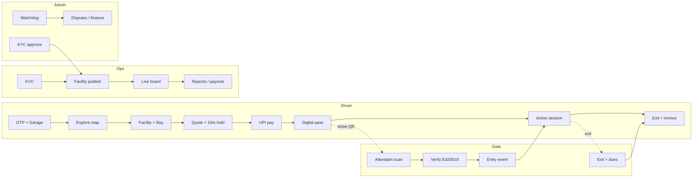

# ParkSpot — UI/UX Design Specification

| Field | Value |
|---|---|
| Document | `docs/design.md` |
| Product | ParkSpot (India-first parking marketplace + operator SaaS) |
| Authority | Aligns to `ParkSpot_Master_Specification_v3.0.md` (§2 personas, §4 workflows, §5 state machines, §7 credentials, §8–9 money/tax) |
| Surfaces | Flutter driver app · Flutter staff/POS app · Operator web SaaS · Platform admin web console |
| Purpose | Single source of truth for **screen flows**, **layout contracts**, and **Figma generation** so every mockup reads as professional, premium, and operationally credible |
| Version | 5.0 (LOCKED: Google Stitch Urban Mobility & Smart Transit Suite) |
| **Figma file** | [ParkSpot UI/UX Design System & Screens](https://www.figma.com/design/3VGO76u6fTNV333cTLYJXY) (`3VGO76u6fTNV333cTLYJXY`) |
| **Stitch Project** | `projects/15000274080821385749` (`Urban Mobility & Smart Transit` Design System: `assets/6f2cd872370148b5b2e7904ab1d527b9`) |
| HTML mockup source | `docs/figma-mockups/` (Full driver pack `flow-driver.html` + Stitch suite `stitch-screens/index.html`) |

> **How to use this file.** Sections 1–3 define brand and tokens. Section 4 is information architecture. Sections 5–8 are role journeys with **frame-level layout specs** (copy these into Figma prompts). Section 9 is the complete screen inventory. Section 10 is the Figma generation playbook (mandatory for premium output). Section 11 covers states, motion, a11y, and content rules.

---

## 1. Design thesis

ParkSpot sells two guarantees (Master Spec §1.1):

| Customer | Guarantee | UI implication |
|---|---|---|
| **Driver** | Certainty — bay free on arrival, price matches quote, entry in seconds | Always show **freshness + source**, **itemized INR quote before pay**, **hold countdown**, **boarding-pass grade digital pass** |
| **Operator** | Revenue protection — every vehicle accounted, cash cannot leak, settlement auditable | Live occupancy truth, mandatory override reasons, shift cash variance, GST-ready statements |

### 1.1 Aesthetic direction (premium, not generic SaaS)

**Name:** *Transit Certainty* — institutional mobility, daylight-legible, India-native finance UX.

| Do | Do not |
|---|---|
| Deep navy + mobility teal; crisp white surfaces; tabular INR and HSRP plates | Purple gradients, neon glow, glassmorphism stacks, emoji decoration |
| One strong visual plane (map or deck plan) with a single docked sheet | Dashboard clutter in first viewport; floating badge stickers on maps |
| Photography of real Indian facilities (metro MLCP, tech-park basement, surface lot) | Abstract blob illustrations as the hero |
| Dense-but-calm data for operator/admin; sparse-and-bold for driver gate moments | Same visual density for all four roles |
| Plus Jakarta Sans + tabular figures | Inter/Roboto/system as primary; decorative script fonts |

### 1.2 Core UX principles (normative)

1. **Uncompromising legibility** — Designed for harsh sunlight on windshield mounts and gloved attendant POS use. Critical text ≥ WCAG AAA contrast.
2. **Honest availability** — Every capacity figure shows `source` + age. Stale/operator-declared never styled as live confirmed (Master Spec §3.3, T7).
3. **Money before commitment** — Full payable with base, increments, platform fee, CGST/SGST (or IGST), and total **before** payment CTA (payable amount invariant).
4. **Operational velocity** — Driver explore → book in ≤ 5 taps for happy path; attendant verify → barrier in < 300 ms feedback loop.
5. **Offline is a mode** — Attendant surfaces show an explicit offline banner, manifest age, and local verify status — never silent failure (T4, T8).
6. **Platform-native cohesion** — 8-pt grid, 48×48 min touch targets, consistent elevation. Material 3 structure with a custom mobility brand layer (not stock M3 purple).

---

## 2. Design tokens

### 2.1 Color

Tuned for outdoor AAA contrast on critical navigation and transaction text.

| Token | Hex | Stitch Token Name | Usage |
|---|---|---|---|
| `primary` / Mobility Deep Teal | `#00685F` | `primary` | Primary brand accent, wayfinding pins, key header emphasis |
| `primary.container` | `#008378` | `primary-container` | Active icon containers, prominent badges |
| `primary.fixed` | `#89F5E7` | `primary-fixed` | High-contrast selected tag highlights, active state backgrounds |
| `action.teal` | `#0D9488` | `overridePrimaryColor` | Primary CTAs, selected bay, route pulse, confirmed links |
| `brand.navy` / secondary | `#0F172A` | `overrideSecondaryColor` | Headers, wordmark, HSRP plate chrome, active nav, institutional text |
| `secondary` | `#565E74` | `secondary` | Secondary text, inactive tab icons, neutral metadata |
| `tertiary` / Electric Transit Green | `#006947` / `#10B981` | `tertiary` | Confirmed RFID/FASTag links, live ultrasonic slot sync pulse |
| `canvas` / background | `#F8F9FF` | `background` / `surface` | App background (cool crisp neutral — not cream) |
| `surface.lowest` | `#FFFFFF` | `surface-container-lowest` | Cards, sheets, digital pass ticket canvas |
| `surface.container` | `#E5EEFF` | `surface-container` | Subtle card grouping containers, list backgrounds |
| `surface.variant` | `#D3E4FE` | `surface-variant` | Accent containers, subtle divider blocks |
| `border` / outline | `#E2E8F0` / `#6D7A77` | `outline` | 1px daylight card borders and separators |
| `text.primary` | `#0B1C30` | `on-surface` / `on-background` | High-contrast body primary text |
| `text.secondary` | `#3D4947` | `on-surface-variant` | Sub-labels, tariff footnotes, helper copy |
| `text.inverse` | `#FFFFFF` | `on-primary` | On navy / deep teal CTA surfaces |

**Semantic status (always pair color + icon + label):**

| Status | Text/icon | Container | Meaning |
|---|---|---|---|
| Available / Confirmed | `#15803D` | `#DCFCE7` | Live free capacity, pass verified |
| Filling / Caution | `#B45309` | `#FEF3C7` | >85% full, overstay warning, lease low |
| Full / Critical / Rejected | `#B91C1C` | `#FEE2E2` | Unavailable, invalid pass, variance short |
| En route / Info | `#0369A1` | `#E0F2FE` | Navigation, pending confirmation |
| Unverified / Stale | `#475569` | `#F1F5F9` + **dashed** `#CBD5E1` border | Operator-declared or past `fresh_until` — **never solid green** |

**Tier capability badges (facility detail):** T0–T4 as compact navy-outline pills with teal fill only for the facility’s active tier.

### 2.2 Typography

**Primary:** Plus Jakarta Sans (geometric, clear `0`/`O`, `1`/`I`).  
**Fallback stack:** `"Plus Jakarta Sans", "Noto Sans Devanagari", system-ui`.  
**Hindi:** Noto Sans Devanagari for body; keep Latin numerals for money/plates.

| Style | Size / Line | Weight | Use |
|---|---|---|---|
| Display Lg | 36 / 44 | Bold | Splash, booking confirmed hero |
| Headline Lg | 30 / 38 | Bold | Section titles, quote total |
| Headline Md | 20 / 28 | SemiBold | Facility name, sheet titles |
| Title Md | 16 / 24 | SemiBold | Bay ID, vehicle class, list titles |
| Body Md | 14 / 20 | Regular | Address, helper, terms |
| Label Sm | 11 / 14 | Medium | Freshness pills, tax lines, coords |
| Data Currency | 22 / 28 | Bold · **tabular nums** | `₹120.00` — never proportional digits |
| Data Plate | 18 / 24 | Bold · tabular · tracking 0.1em | `KA 01 MJ 8821` uppercase |

### 2.3 Space, radius, elevation

| Token | Value |
|---|---|
| Space | 4 / 8 / 16 / 24 / 32 / 48 |
| Touch target | ≥ 48×48 (attendant critical actions ≥ 56×56) |
| Radius sm | 8 (chips, plate badge) |
| Radius md | 16 (cards, selectors) |
| Radius sheet | 24 top (bottom sheets) |
| Radius pill | 9999 (status only — not primary buttons) |

| Elevation | Treatment |
|---|---|
| L0 Canvas | Flat `#F8FAFC` |
| L1 Card | White + 1px `#E2E8F0` + `0 1px 3px rgba(15,23,42,0.05)` |
| L2 Selected | White + 1.5px teal border + `0 4px 12px rgba(15,23,42,0.08)` |
| L3 Sheet / sticky bar | White + top border + `0 -4px 16px rgba(15,23,42,0.08)` |
| L4 Modal / pass overlay | White + `0 12px 32px rgba(15,23,42,0.16)` |

### 2.4 Iconography & imagery

- **Icons:** Phosphor or Material Symbols Outlined, 1.5–2px stroke, navy default, teal for active.
- **Map:** Light basemap (desaturated roads), teal route polyline, status-colored facility pins — not dark-mode maps for driver default.
- **Deck plans:** Architectural 2D (aisles, pillars, lift cores, fire exits) — treat like a product diagram, not a cartoon.
- **Pass QR:** High-contrast black modules on white; quiet zone ≥ 4 modules; booking meta outside the QR.

---

## 3. Product surfaces & shells

```
ParkSpot
├── Driver app (Flutter) ........ mobile 390×844 @2x · bottom nav 4 tabs
├── Attendant / staff app ....... mobile POS 390×844 · task dock (no consumer nav)
├── Operator SaaS ............... desktop 1440×900 · left nav + top facility switcher
└── Platform admin console ...... desktop 1440×900 · left nav + city cluster switcher
```

### 3.1 Driver bottom navigation

| Tab | Purpose |
|---|---|
| **Explore** | Map + search + vehicle class + freshness |
| **Bookings** | Active session, upcoming, history, invoices |
| **Passes** | Monthly / corporate season products |
| **Profile** | Garage (6 classes), UPI methods, language EN/HI, support, DPDP |

### 3.2 Attendant task dock (shift-bound)

| Tab | Purpose |
|---|---|
| **Scan** | QR viewfinder + plate / booking lookup |
| **Walk-in** | Admit unbooked vehicle + slip |
| **Exit** | Dues, UPI QR / cash, clearance |
| **Shift** | Float, collections, close & handover |

### 3.3 Operator SaaS primary nav

Overview · Live board · Zones & slots · Tariffs · Bookings · Staff & shifts · Reports · Payouts · Disputes · Settings (facility / KYC / tier)

### 3.4 Admin console primary nav

Operations · KYC queue · Facility review · Bookings timeline · Support · Disputes · Finance (payouts, tax, recon) · Fraud · Audit · Edge fleet · Feature flags

---

## 4. End-to-end journey map (all roles)



Normative workflows from Master Spec §4 that **must** have dedicated UI coverage:

| Spec § | Journey | Primary screens |
|---|---|---|
| 4.1 | Advance reservation | DRV-01 → 09 |
| 4.2 | Floating session (pay-as-you-use) | DRV-03F, DRV-04F, DRV-06 |
| 4.3 | Walk-in admission & exit | ATT-16, ATT-12 |
| 4.4 | Extension | DRV-07 |
| 4.5 | Cancel & refund | DRV-22 |
| 4.6 | SOS bay occupied | DRV-19 |
| 4.7 | EV charging (T4) | DRV-27 |
| 4.8 | Attendant shift lifecycle | ATT-01 → ATT-05 |
| 4.9 | Operator onboarding KYC | OPR-01 → OPR-03 |
| 4.10 | Operator daily ops | OPR-14, OPR-15 |
| 4.11 | Settlement & payout | OPR-18, ADM-08 |
| 4.12 | Disputes | DRV-18, OPR-19, ADM-05 |
| 4.13 | Corporate | CORP-01.. |
| 4.14 | Monthly pass | DRV-21, OPR-20 |

---

## 5. Role 1 — Driver app flows & frame specs

**Frame size:** `390 × 844` (iPhone 14 / common Android). Safe area top 59 / bottom 34.  
**Chrome:** Status bar light content on navy/map; dark content on canvas. Bottom nav 64 + home indicator.

### 5.1 Flow A — Auth & garage (D01, D02)

```
AUTH-01 Splash → AUTH-02 Phone (+91) → AUTH-03 OTP → AUTH-04 Profile
  → DRV-18 Vehicle garage (add first vehicle) → Explore
```

#### AUTH-01 Splash
- Full-bleed soft gradient canvas (`#F8FAFC` → `#E0F2FE` subtle, **not purple**).
- Centered wordmark **ParkSpot** (Display Lg, navy) + thin teal underline 32px.
- One line: “Bay certainty. Honest price. Fast gate.”
- No secondary marketing blocks.

#### AUTH-02 Phone
- Headline: “Sign in with mobile”
- Prefixed `+91` locked field; large digit keyboard.
- Primary CTA: Continue (teal, full width, 52h).
- Footer: DPDP consent one-liner + link.

#### AUTH-03 OTP
- 6 boxes, auto-advance; SMS autofill affordance.
- Resend with 30s timer; WhatsApp fallback link (DLT).

#### AUTH-04 / DRV-18 Garage
- Empty state: illustration of HSRP plate + CTA “Add vehicle”.
- Add vehicle sheet: class grid (6 classes), plate input with live format mask, optional dims, EV toggle, FASTag link (disabled until T3 facility context).
- Plate preview as physical HSRP chrome badge.

---

### 5.2 Flow B — Discover → reserve → pay → pass (§4.1)

```
DRV-01 Explore → DRV-12 Filters → DRV-02 Facility detail
  → DRV-02B Bay map (NUMBERED) | DRV-02A Zone capacity (AGGREGATED)
  → DRV-03 Quote → DRV-04 Checkout → DRV-05 Pass
```

#### DRV-01 Explore (flagship)
**Layout zones (top → bottom):**
1. **Search HUD** (translucent white 16px radius): destination field, mic optional, GPS.
2. **Vehicle class strip** (horizontal): Cycle · Two-wheeler · Car · Auto · Van/SUV · Truck — selected = teal border L2.
3. **Map plane** (dominant 55–60% height): pins by status color; selected pin expands.
4. **Results sheet** (peek 28% → expand): facility cards.

**Facility card content (order fixed):**
- Name + distance
- Freshness pill: `Updated 2m ago · Ledger` | stale = grey dashed
- From-price `₹30/hr` tabular
- Amenities row max 3 icons (covered, EV, CCTV)
- Tier chip `T1`

**Figma quality bar:** Map must look like a real light basemap with road hierarchy; pins crisp; sheet not a generic list card dump.

#### DRV-12 Filters (modal sheet)
- Clearance toggle tied to garage vehicle height.
- Radius slider 0.5–15 km.
- Freshness: Live only / All.
- Structure: Covered · Surface · MLCP.
- EV charger, hours, max ₹/hr.
- Sticky Apply (teal) + Reset.

#### DRV-02 Facility detail
- Hero photo carousel (real lot imagery), verified badge.
- Entrance pin CTA distinct from “Navigate to destination”.
- Compatibility matrix vs active vehicle.
- Rate card accordion (bands, grace, overstay, cancel policy).
- Operator identity + GSTIN if registered.
- Availability block with source/age.
- Sticky CTA: “Select bay” or “Continue” (aggregated).

#### DRV-02B Deck bay selector (NUMBERED_BAYS)
- Floor tabs: B1 (Full) · **B2** · L1 · Terrace.
- 2D blueprint: one-way arrows, pillars P-08…, Lift Core, fire exit.
- Bay states: free (white+green dot) · selected (teal L2) · occupied (muted) · EV (bolt) · blocked (hatch).
- Docked sheet: Bay ID, walk time to lift, clearance check, quote preview, **Hold for 10:00** CTA.

#### DRV-02A Aggregated zone (no bay pick)
- Zone list with free count + freshness.
- “Guaranteed entry” copy (not Guaranteed Bay SLA).
- Duration + arrival window → quote.

#### DRV-03 Quote summary
- Trip: facility, zone/bay, window, duration steppers.
- Vehicle binding with switcher.
- **Price breakdown (required):**
  - Parking tariff
  - Platform fee
  - CGST 9% / SGST 9% (or IGST) on taxable lines per Master Spec §9
  - **Total payable** (Headline Lg)
- Policy version + quote expiry timer.
- CTA: “Hold bay & pay” → starts 10-minute lease.

#### DRV-04 Checkout
- Circular **lease countdown** (prominent).
- UPI apps row: GPay, PhonePe, Paytm, BHIM + “Enter UPI ID”.
- Cards / netbanking secondary.
- Disabled CTA + spinner on tap (idempotency).
- States: Processing · Pending confirmation (webhook delay) · Failed (retry same key) · Success → DRV-05.

#### DRV-05 Digital pass (flagship)
Boarding-pass composition:
- Notch-cut white pass card on navy canvas.
- Facility + Bay `B2-19` + window.
- HSRP plate block.
- **Ed25519-signed dynamic QR** (not “TOTP”); quiet zone respected.
- Anti-reuse: live clock watermark `14:48:22 IST` (pulsing opacity).
- Brightness boost control; Add to Google Wallet.
- CTAs: Navigate to **entrance pin** · SOS (secondary).

---

### 5.3 Flow C — Arrive → session → exit (§4.1 steps 7–12)

```
DRV-05 → (gate) → DRV-06 Active session → DRV-07 Extend | DRV-08 Overstay
  → DRV-09 Invoice
```

#### DRV-06 Active session
- Elapsed / booked progress ring.
- Bay + pillar wayfinding.
- Dues so far (floating) or prepaid remaining.
- +30m / +1h / +2h.
- Pre-settle overstay.
- Find car / pillar QR (phase).

#### DRV-07 Extend
- Capacity re-check messaging.
- Incremental band breakdown.
- Pay CTA or “applied to floating mandate”.

#### DRV-08 Overstay
- Amber→red escalation.
- Grace exhausted; surcharge matrix.
- Pay before gate CTA.

#### DRV-09 Invoice
- Session timestamps (entry/exit methods).
- Operator parking receipt + platform fee tax invoice (per §9 — do not invent Sec 9(5) deemed supplier UI).
- PDF / WhatsApp share.
- Rate session (optional).

---

### 5.4 Flow D — Floating session (§4.2)

```
DRV-02 → DRV-03F Floating quote → DRV-04F OTM / pre-auth → DRV-05 → DRV-06
  → top-up sheet at 80% → exit capture
```

- Emphasize **minimum charge**, per-increment rate, **pre-auth amount**, daily cap.
- Top-up prompt sheet; decline path → gate settlement required.

### 5.5 Flow E — Cancel, SOS, passes

#### DRV-22 Cancellation
- Policy table matching §4.5 (>60m / 15–60 / <15).
- Refund lines + credit note promise.
- Stepper: Requested → Inventory released → PSP refund → Completed (no false “instant” promise).

#### DRV-19 SOS bay occupied
- Photo required; geofence/entry gate.
- Progress: Finding bay → Reassigned (new pass) → SLA breached (refund + credit at T1+).
- Abuse residual copy subtle.

#### DRV-21 Monthly pass
- Dark navy pass hero (premium metal feel — matte, not glitter).
- Validity bar; AutoPay toggle with 24h pre-debit disclosure.
- Catalog: Executive 24×7 · Weekday · Two-wheeler.

#### DRV-20 Bookings list
- Active (live timer) · Upcoming · Past.
- Search; invoice affordance.

---

## 6. Role 2 — Attendant POS flows & frame specs

**Frame:** `390 × 844`, rugged Android POS aesthetic (Sunmi-class): thicker action buttons, high-contrast, always-visible shift chip.

### 6.1 Shift lifecycle (§4.8)

```
ATT-01 Login (PIN/biometric) → ATT-02 Open shift (float count)
  → ATT-10 Scan loop ↔ ATT-16 Walk-in ↔ ATT-12 Exit
  → ATT-05 Close shift → handover
```

#### ATT-01 / ATT-02
- Facility + lane binding confirmation.
- Opening float denomination grid (₹500…₹10).
- Offline key status: “Keys valid · Manifest 11h 40m”.

#### ATT-10 Scanner (flagship)
- Full-bleed camera; emerald reticle.
- Torch; manual plate / booking code.
- Top telemetry strip: POS-ID, attendant name, battery, printer, **ONLINE | OFFLINE**.
- Success flash: `PASS VERIFIED · <300ms` + plate + bay.
- Reject sheet: reason codes (expired, revoked nonce, plate mismatch, wrong facility).

#### ATT-11 Confirm entry
- Large plate + class + bay + window.
- Primary: Confirm & open barrier (T1) / Confirm entry (T0).
- Override: secondary, requires reason (+ supervisor PIN if repeated).

#### ATT-16 Walk-in
- 3-step: Class → Plate (+ photo) → Confirm.
- Float buffer remaining warning.
- `CAPACITY_FULL` blocking state; override audited.
- Print thermal / SMS slip.

#### ATT-12 Exit clearance
- Dues breakdown; prepaid zero-dues auto-clear.
- Dynamic UPI QR (amount-locked) preferred; cash with denomination note.
- Receipt + barrier.

#### ATT-13 Offline mode
- Persistent amber banner: “OFFLINE · local Ed25519 verify · queue N events”.
- Manifest age; clock skew warning if large.

#### ATT-05 Shift close
- Expected vs counted; Δ badge ZERO / SHORT / OVER.
- Loop-vs-digital delta (T1+).
- Handover slip; manager ack.

#### ATT-08 Incident
- Categories: damage, squatter, tailgate, dispute + photo.

---

## 7. Role 3 — Operator SaaS flows & frame specs

**Frame:** `1440 × 900` desktop. Left nav 240. Content max 1120. Density: information-rich, not sparse marketing.

### 7.1 Onboarding (§4.9)

```
OPR-01 Org signup → OPR-01B Entity/PAN/GSTIN → OPR-01C Bank penny-drop
  → OPR-01D Documents → OPR-02 Facility map/geofence/entrances
  → OPR-03 Zones & capacity → OPR-04 Rate card → Submit PENDING_REVIEW
```

- Wizard progress 7 steps; under-15-minute messaging.
- Rejection reasons resurface inline for resubmit.

### 7.2 Daily operations (§4.10)

#### OPR-14 Live operations board (flagship)
- Occupancy by zone: reserved / declared / loop (T1) with freshness.
- Arrivals next 30m; overstays; open incidents.
- Gate/lane status tiles (T1+).
- Staff on shift.

#### OPR-15 Zones & blocks
- NUMBERED vs AGGREGATED mode clear.
- Block bay/capacity: reason + window mandatory.

#### OPR-05 Rate card editor
- Per class; bands; walk-in; overstay; cancel policy; effective dates.
- **Preview calculator** with sample quote (same breakdown as driver).

#### OPR-06 Float buffer
- Measured walk-in % vs configured buffer; apply suggestion (floor 5%).

#### OPR-17 Reports
- Revenue by product/method; occupancy; no-shows; leakage (T1+).
- Exports CSV + GSTR-1 helper (operator supplies parking; platform TCS context in footnotes — accurate to §9).

#### OPR-18 Payouts
- Batch list; gross → fees → TCS → TDS → net; UTR; PDF statement.

#### OPR-19 Disputes inbox
- SLA timers; evidence upload.

#### OPR-09 Staff
- Invite, scope, rosters, device enrolment.

#### OPR-21 Tier commissioning
- Checklist T0→T1…; device pairing; test cycle results.

---

## 8. Role 4 — Platform admin flows & frame specs

**Frame:** `1440 × 900`. Executive calm: navy headers, teal sparingly for CTAs, red only for live incidents.

#### ADM-01 Operations command (flagship)
- City cluster switcher: All India · Delhi-NCR · Bengaluru · Mumbai · …
- KPI strip: facilities online, network occupancy, GMV today, open flags.
- Map 60% + incident stream 40%.
- Incident cards with Investigate / Freeze actions.

#### ADM-02 KYC review
- Document viewer; penny-drop result; approve/reject with reasons; audit.

#### ADM-03 Facility listing review
- Geometry audit, photos, policy completeness, quality score; publish/suspend.

#### ADM-04 Booking timeline
- Full event spine: quote, pay, credential, gate, notify.

#### ADM-05 Support / disputes
- Macros; refund limits; evidence (gate photos T2, loops T1).

#### ADM-08 Finance
- Payout dual-control; PSP recon exceptions; TCS/TDS export desks.

#### ADM-06 Fraud watchlist
- SOS abuse, promo, duplicate plates, override spikes, webhook anomalies.

#### ADM-11 Audit explorer
- Actor, action, before/after, request ID.

#### ADM-12 DPDP rights desk
- Access/correction/erasure; 90-day SLA.

---

## 9. Complete screen inventory (Figma page structure)

Organize Figma as **one file / four pages** (Driver · Attendant · Operator · Admin). Cover = design system.

### 9.1 Design system page
- Color styles, text styles, effects, components (see §10.3).

### 9.2 Driver screens

| ID | Screen | Priority | Frame |
|---|---|---|---|
| AUTH-01 | Splash (brand-first) | M | 390×844 |
| AUTH-02 | Phone OTP entry | M | 390×844 |
| AUTH-03 | OTP verify | M | 390×844 |
| AUTH-04 | Profile setup | M | 390×844 |
| AUTH-05 | App permissions (location / push / WhatsApp) | M | 390×844 |
| AUTH-06 | Consent & agreements (Terms · Privacy · DPDP) | M | 390×844 |
| DRV-18 | Vehicle garage | M | 390×844 |
| DRV-01 | Explore map | M | 390×844 |
| DRV-12 | Filters sheet | M | 390×844 |
| DRV-02 | Facility detail | M | 390×844 |
| DRV-02P | Product fork (reservation / floating) | M | 390×844 |
| DRV-02B | Bay deck map | M | 390×844 |
| DRV-02A | Aggregated zone pick | M | 390×844 |
| DRV-03 | Quote (reservation) | M | 390×844 |
| DRV-03F | Quote (floating) | M | 390×844 |
| DRV-04 | UPI checkout + hold | M | 390×844 |
| DRV-04P | Payment pending (webhook) | M | 390×844 |
| DRV-04X | Payment failed | M | 390×844 |
| DRV-04E | Lease / hold expired | M | 390×844 |
| DRV-04F | OTM pre-auth | M | 390×844 |
| DRV-04T | Floating top-up | M | 390×844 |
| DRV-05 | Digital pass QR | M | 390×844 |
| DRV-06 | Active session | M | 390×844 |
| DRV-07 | Extend | M | 390×844 |
| DRV-07X | Extension unavailable | S | 390×844 |
| DRV-08 | Overstay | M | 390×844 |
| DRV-09 | Invoice | M | 390×844 |
| DRV-19 | SOS occupied | S | 390×844 |
| DRV-19R | SOS rerouted | S | 390×844 |
| DRV-19S | SOS SLA breached | S | 390×844 |
| DRV-20 | Bookings hub | M | 390×844 |
| DRV-21 | Monthly passes | S | 390×844 |
| DRV-22 | Cancel & refund | M | 390×844 |
| DRV-22T | Refund tracker | S | 390×844 |
| DRV-23 | Support case | M | 390×844 |
| DRV-24 | Profile & settings hub | M | 390×844 |
| DRV-24D | DPDP rights (export / erase / consents) | M | 390×844 |
| DRV-25 | Notifications inbox | S | 390×844 |
| DRV-26 | Network error | S | 390×844 |
| DRV-27 | EV charging session | C | 390×844 |
| DRV-28 | Notification preferences | M | 390×844 |
| DRV-29 | Legal & about hub | M | 390×844 |
| DRV-29A | About ParkSpot | M | 390×844 |
| DRV-29T | Terms of Service | M | 390×844 |
| DRV-29P | Privacy Policy (DPDP) | M | 390×844 |
| DRV-30 | Payment methods | M | 390×844 |
| DRV-31 | Help & FAQ | M | 390×844 |
| DRV-20E | Bookings empty state | S | 390×844 |
| DRV-32 | Language | S | 390×844 |
| DRV-33 | Wallet & credits | S | 390×844 |
| DRV-34 | Location permission denied | S | 390×844 |

### 9.3 Attendant screens

| ID | Screen | Priority | Frame |
|---|---|---|---|
| ATT-01 | Shift login | M | 390×844 |
| ATT-02 | Open shift / float | M | 390×844 |
| ATT-03 | Plate lookup | M | 390×844 |
| ATT-10 | QR scanner | M | 390×844 |
| ATT-10R | Pass rejected | M | 390×844 |
| ATT-11 | Entry confirm | M | 390×844 |
| ATT-08O | Override + supervisor PIN | M | 390×844 |
| ATT-16 | Walk-in | M | 390×844 |
| ATT-16F | Capacity full (no admit) | M | 390×844 |
| ATT-12 | Exit & dues | M | 390×844 |
| ATT-12Q | Exit UPI QR collect | M | 390×844 |
| ATT-05H | Shift handover | S | 390×844 |
| ATT-13 | Offline banner states | M | 390×844 |
| ATT-05 | Shift close | M | 390×844 |
| ATT-08 | Incident capture | S | 390×844 |
| ATT-11L | Lane / barrier (T1) | M | 390×844 |

### 9.4 Operator screens

| ID | Screen | Priority | Frame |
|---|---|---|---|
| OPR-01.1–01.7 | KYC wizard (7 steps: entity → GST → bank → docs → signatory → facility draft → submit) | M | 1440×900 |
| OPR-02 | Facility editor + map | M | 1440×900 |
| OPR-03 | Zones / slots wizard | M | 1440×900 |
| OPR-05 | Rate card editor | M | 1440×900 |
| OPR-06 | Float buffer | M | 1440×900 |
| OPR-14 | Live board | M | 1440×900 |
| OPR-15 | Blocks & capacity | M | 1440×900 |
| OPR-09 | Staff & devices | M | 1440×900 |
| OPR-10 | Bookings desk | M | 1440×900 |
| OPR-10D | Booking detail | M | 1440×900 |
| OPR-20 | Pass pools | S | 1440×900 |
| OPR-17 | Reports | M | 1440×900 |
| OPR-18 | Payouts | M | 1440×900 |
| OPR-19 | Disputes | M | 1440×900 |
| OPR-21 | Tier commissioning | M | 1440×900 |

### 9.5 Admin screens

| ID | Screen | Priority | Frame |
|---|---|---|---|
| ADM-01 | Operations command | M | 1440×900 |
| ADM-02 | KYC queue | M | 1440×900 |
| ADM-03 | Facility review | M | 1440×900 |
| ADM-04 | Booking timeline | M | 1440×900 |
| ADM-05 | Support / disputes | M | 1440×900 |
| ADM-05D | Dispute decision | M | 1440×900 |
| ADM-07 | Feature flags (P07) | M | 1440×900 |
| ADM-06 | Fraud | S | 1440×900 |
| ADM-08 | Finance / payouts / tax | M | 1440×900 |
| ADM-10 | Reconciliation | M | 1440×900 |
| ADM-11 | Audit log | M | 1440×900 |
| ADM-12 | DPDP desk | M | 1440×900 |
| ADM-13 | Edge fleet | M | 1440×900 |

### 9.6 Complete mockup delivery status

| Surface | Screen count | Complete source | Figma editable frames |
|---|---|---|---|
| Driver | **50** (core + legal/consent/settings production pack) | [`flow-driver.html`](figma-mockups/flow-driver.html) | Partial (DRV-01, 02B, 04, 05) |
| Attendant | 16 (shift + reject/override/UPI/handover) | [`flow-attendant.html`](figma-mockups/flow-attendant.html) | Partial (ATT-10) |
| Operator | 21 (KYC×7 + ops + pass pools + booking detail) | [`flow-operator.html`](figma-mockups/flow-operator.html) | Partial (OPR-14) |
| Admin | 13 (ops + dispute decision + feature flags) | [`flow-admin.html`](figma-mockups/flow-admin.html) | Partial (ADM-01) |
| **Gallery hub** | **100 screens** | [`figma-mockups/index.html`](figma-mockups/index.html) | — |

**Canonical complete UI:** open `docs/figma-mockups/index.html` (horizontal scroll per role = full journey).  
Generator: `docs/figma-mockups/generate_all.py` (re-run to regenerate).

Figma file (tokens + flagships): https://www.figma.com/design/3VGO76u6fTNV333cTLYJXY  
Starter plan MCP rate limit blocked pushing all 60 frames in one session; remaining frames should be imported from the HTML flows when limits reset or plan upgrades.

### 9.7 Figma file structure (Starter · 3 pages)

| Page | Contents |
|---|---|
| `00 · Design System` | Cover, color tokens (16 variables), swatches |
| `01 · Driver + Attendant` | Flagships: DRV-01, DRV-02B, DRV-04, DRV-05, ATT-10 |
| `02 · Operator + Admin` | Flagships: OPR-14, ADM-01 |

### 9.8 Prototype & prior assets

| Asset | Location |
|---|---|
| **Complete HTML flows (source of truth for all screens)** | `docs/figma-mockups/index.html` |
| Figma file (tokens + flagships) | https://www.figma.com/design/3VGO76u6fTNV333cTLYJXY |
| Interactive HTML prototype | `prototype/index.html` |
| Prior Stitch project (reference only) | [Stitch 15000274080821385749](https://stitch.withgoogle.com/projects/15000274080821385749) |
| Related workflow doc | `docs/MASTER_UI_WORKFLOW_AND_DESIGN_SYSTEM.md` |
| User-flow narrative | `docs/user-flows.md` |

When Stitch/Figma conflict with Master Spec v3.0 (credential algorithm, tax supplier model, valet), **this file + Master Spec win**.

---

## 10. Figma generation playbook (premium output)

Use this section verbatim when generating or prompting Figma / AI design tools.

### 10.1 Global generation rules

1. **Brand first on splash and pass** — “ParkSpot” is the hero signal; headlines never overpower the wordmark.
2. **One job per screen** — No stats strips on driver explore; no marketing promos on checkout.
3. **Real visual anchors** — Map, deck blueprint, camera viewfinder, or facility photo — not empty gradients.
4. **No hero stickers** — No floating “50% OFF” badges on maps or passes.
5. **Cards only for interaction** — Facility result, bay selection, pass, KPI tiles on ops — not decorative wrappers.
6. **India-native finance chrome** — `₹` tabular, UPI app marks, HSRP plate, IST timestamps, CGST/SGST lines.
7. **Credential accuracy** — Label passes as **Ed25519-signed**; offline verify; single-use nonce — never TOTP/shared-secret copy.
8. **Honest availability styling** — Stale = grey dashed pill; live ledger = green; never fake “LIVE” on operator-declared stale data.
9. **Light premium default** — Driver and attendant default to light outdoor UI. Admin/operator may use slightly denser surfaces; avoid pure dark-mode-first.
10. **Consistent component kit** — Same button, chip, input, sheet across all driver frames before inventing one-offs.

### 10.2 Per-role visual density

| Role | Density | Mood |
|---|---|---|
| Driver | Sparse, large type on money/pass | Calm confidence |
| Attendant | Dense actions, huge CTAs | Rugged, fast, error-proof |
| Operator | Data-dense tables + gauges | Professional SaaS |
| Admin | Command-center + queues | Authoritative, audit-ready |

### 10.3 Component inventory (build in Figma first)

- Buttons: Primary teal · Secondary outline · Destructive · Ghost · POS XL
- Chips: Freshness · Tier · Vehicle class · Status
- Inputs: Text · Plate · OTP · Search · Stepper
- Cards: Facility · Booking · Pass · Incident · KPI
- Sheets: Filter · Quote · Payment · SOS
- Nav: Driver tab bar · Attendant dock · SaaS side nav
- Feedback: Toast · Banner offline · Empty · Error inline
- Data: Currency · Plate · Progress ring · Countdown

### 10.4 Sample Figma / AI prompt (driver pass)

```
Mobile 390x844 light UI for ParkSpot India parking app. Screen: confirmed digital
parking pass. Deep navy (#0F172A) background. Center white boarding-pass card with
side notches, facility name "Indiranagar Metro MLCP", bay B2-19, HSRP plate
KA 01 MJ 8821, large high-contrast QR, live IST timestamp watermark, teal primary
button "Boost brightness", secondary "Navigate to entrance". Plus Jakarta Sans,
tabular rupees if shown. Premium fintech-mobility, no purple, no neon glow,
no emoji, no coupon badges. High-end production mockup.
```

### 10.5 Sample prompt (attendant scanner)

```
390x844 rugged Android POS UI, ParkSpot attendant. Camera viewfinder full bleed,
emerald alignment reticle, top status bar POS-04 · Attendant · Battery 88% ·
OFFLINE RS256/Ed25519 LOCAL SYNC. Bottom sheet PASS VERIFIED · BARRIER OPENING
with plate match and bay B2-19. Large gloved-friendly Confirm button. Teal and
navy, daylight legible, Sunmi-class hardware chrome, premium operational software.
```

### 10.6 Sample prompt (operator live board)

```
1440x900 SaaS dashboard ParkSpot operator. Left nav, top facility switcher
"Indiranagar Metro MLCP · 850 bays · Tier 1". Live occupancy by floor B1/B2/B3/
Terrace with honest freshness labels, arrivals next 30 min, gate status tiles,
today collections with CGST/SGST breakdown. Clean enterprise density, navy/teal
system, white surfaces, no purple gradients, production fintech quality.
```

### 10.7 Delivery checklist before calling a frame “done”

- [ ] Correct frame size and safe areas  
- [ ] Tokens match §2 (no off-palette accents)  
- [ ] Freshness/source visible wherever capacity appears  
- [ ] Money breakdown complete before pay  
- [ ] Hold countdown on checkout  
- [ ] Pass shows plate + bay + QR quiet zone + IST watermark  
- [ ] Attendant offline state designed, not omitted  
- [ ] Hindi string expansion (+30% width) checked on key screens  
- [ ] Empty, loading, error, success variants for primary flows  
- [ ] Spec ID (DRV-05 etc.) named on frame  

---

## 11. States, motion, accessibility, content

### 11.1 Universal UI states

Every primary screen needs: **Loading skeleton** · **Empty** · **Error with retry** · **Success** · **Partial/degraded** (stale data, pending webhook, offline).

Booking visual states track Master Spec §5.1: `HELD` (countdown), `PENDING_CONFIRMATION`, `CONFIRMED`, `CHECKED_IN`, `OVERSTAY_ACTIVE`, `COMPLETED`, `CANCELLED`, `NO_SHOW`, `SLA_BREACHED`.

### 11.2 Motion (2–3 intentional motions per flagship flow)

| Motion | Where | Spec |
|---|---|---|
| Sheet spring | Explore results, filters | 280–320ms ease-out |
| Countdown pulse | Lease hold, pass watermark | Opacity 100↔70, 1.2s |
| Verify flash | Attendant accept | Green wash 180ms + haptic |
| Pin focus | Map select | Scale 1→1.08, teal ring |

Honor reduced-motion: replace pulses with static badges.

### 11.3 Accessibility (D25)

- Min touch 48×48; attendant primary 56×56.
- Contrast AAA for money, plate, CTAs.
- Screen-reader labels on map pins and bay cells.
- Don’t rely on color alone for availability — icon + text.
- OTP and plate fields support large text / Dynamic Type.

### 11.4 Content & localization

- EN default; HI scaffold Phase 1, complete Phase 2.
- IST everywhere in UI; store UTC.
- Never promise “instant refund”; use PSP-accurate timelines (§4.5).
- Support SLA visible on case create.
- Valet / key custody: **out of scope** — do not design valet flows (Master Spec §2.4).

### 11.5 Critical interaction rules (carry into every mockup)

1. Payable amount invariant — full GST-aware total before auth.  
2. Atomic 10-minute hold visible during checkout.  
3. Payment CTAs disable + spinner; idempotency key implied in UX copy (“Don’t close the app”).  
4. Offline attendant watermark + local verify.  
5. Pass brightness boost + anti-screenshot watermark.  
6. Overrides require reason (and supervisor PIN when repeated).  
7. Cash variance > ₹200 or >1% flags a case on shift close.

---

## 12. Mapping to Master Spec (traceability)

| Design area | Master Spec |
|---|---|
| Personas & features | §2.1–2.3 |
| Availability truth UI | §3.3 |
| Workflows | §4.1–4.14 |
| Booking / shift / KYC states | §5 |
| Pass / offline | §7 |
| Quotes / SLA | §8 |
| Payments, ledger, TCS/TDS display | §9 |
| DPDP surfaces | §16 |
| Non-goals (no valet, no challan, no marketplace clutter) | §1.6, §2.4 |

---

## 13. Revision log

| Version | Date | Summary |
|---|---|---|
| 3.x | Oct 2026 | Prior SmartPark/Stitch-oriented inventory |
| **4.0** | 24 Oct 2026 | Full ParkSpot v3.0-aligned UI/UX flows, Figma frame contracts, premium generation playbook, corrected credential/tax/non-goal guidance |
| **4.1** | 24 Oct 2026 | Figma file created with design tokens + 7 flagship editable screens; HTML mockup gallery under `docs/figma-mockups/` |
| **4.2** | 24 Oct 2026 | Complete 60-screen Must-priority HTML flows (Driver 26 · Attendant 10 · Operator 13 · Admin 11); gallery + generator; Figma sync pending MCP limits |
| **4.3** | 24 Oct 2026 | Premium visual pass: local photo assets (facility/garage/map/HSRP/QR), upgraded CSS depth/glass/gradients, `premium-showcase.html` photo-led flagships |
| **4.4** | 24 Oct 2026 | Gap fill vs Master Spec: Driver payment/SOS/network states; Attendant reject/override/capacity/UPI/handover; Operator KYC 7-step + pass pools + booking detail; Admin dispute decision + P07 flags → **86 HTML screens** |
| **4.5** | 24 Oct 2026 | Driver production pack: permissions, consent/agreements, About/Terms/Privacy, notification prefs, payments, help/FAQ, DPDP rights, wallet, language, empty/location-denied states; premium splash + settings chrome → **50 Driver / 100 total** |
| **4.6** | 24 Oct 2026 | Five Driver visual iterations with full onboarding — board at `figma-mockups/iterations/` |
| **4.7** | 24 Oct 2026 | Anti-slop theme rewrite (no teal/navy glass candy): A HSRP Official · B Gate Black · C Thermal Receipt · D Sodium Basement · E Midday Stone |
| **4.8** | 24 Oct 2026 | Round 3: **distinct layouts** per iteration (not recolors) — A list/form desk · B map+FAB hardware · C thermal slip · D deck blueprint stories · E editorial split |

**Owner:** Design + Product. Engineering implements Flutter/web against these frames; QA maps cases in `docs/QA_TEST_MATRIX.md` to screen IDs above.
